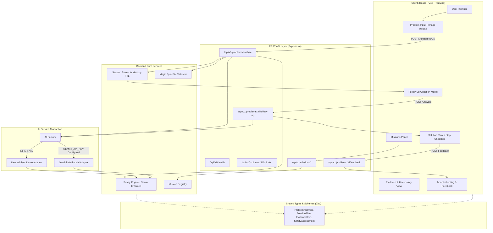

# FixIt AI — Architecture Specification

## 1. System Overview
FixIt AI is a safety-first, multimodal triage and remediation assistant for everyday household, dorm, and office care problems. It processes natural language descriptions and optional photographs, separates confirmed facts from visual observations and inferences, enforces server-side safety invariants before generating advice, and provides structured, interactive action plans.

FixIt AI was built with a modular contract architecture designed to accept **5 unpredictable hackathon missions** without disrupting the core workflow.

---

## 2. Architecture Diagram



---

## 3. Package Structure
FixIt AI is organized as a clean npm workspace monorepo:

- **`shared`** (`@fixit/shared`):
  - Shared TypeScript types and runtime Zod validation schemas.
  - Contracts for `ProblemAnalysis`, `SafetyAssessment`, `SolutionPlan`, `EvidenceItem`, `UserFeedback`, `TroubleshootingResult`, and `MissionDefinition`.
  - Zero external dependencies other than `zod` and `typescript`.
- **`server`** (`@fixit/server`):
  - Express REST API running on Node.js 20.
  - Server-enforced `SafetyEngine` intercepting hazardous materials, chemical mixing (bleach + ammonia/acids), electrical fire risks, and structural hazards.
  - Image magic byte validator (`validateImageBuffer`) verifying actual file signatures (JPEG `FF D8 FF`, PNG `89 50 4E 47`, WebP `RIFF..WEBP`).
  - Provider-agnostic `AIServiceInterface` with `GeminiMultimodalAdapter` and `DeterministicDemoAdapter`.
  - In-memory `SessionStore` with TTL cleanup.
  - Central `MissionRegistry` with feature flag management.
- **`client`** (`@fixit/client`):
  - Modern, responsive React 18 interface with Vite, Tailwind CSS, and Lucide icons.
  - Deep teal/emerald palette with high contrast and accessible focus states.
  - Explicit evidence separation (Reported Facts, Image Observations, Inferred Uncertainties).
  - Interactive checklists, caution callouts, follow-up modals, and honest Demo Mode badge.

---

## 4. Safety Architecture: Server-Side Enforcement
Unlike generic AI wrappers that rely exclusively on model prompt adherence, FixIt AI enforces safety **in application code** both before and after model inference:
1. **Input Pre-Scan**:
   - `evaluateSafety(text)` inspects user text for hazardous keywords, chemical mixing patterns (e.g. `bleach.*ammonia`), electrical water hazards, acute injuries, and structural collapses.
   - If triggered, the service immediately generates an emergency safety escalation, returns vetted precautions, and halts standard cleaning instructions.
2. **Output Sanitization**:
   - `sanitizeProposedPlan(safetyAssessment, proposedSteps)` audits model-generated instructions before they are returned to the client.
   - If model output recommends mixing prohibited chemicals or suggests water on electrical panels, the response is rejected or overridden.

---

## 5. Evidence & Uncertainty Model
To prevent hallucinated facts and unwarranted claims, FixIt AI enforces strict schema separation:
- **`user_input`**: Information explicitly provided by the user in text.
- **`image_observation`**: Physical traits (color, shape, visible marks) identified from actual image inspection.
- **`model_inference`**: Probabilistic assessments (e.g. "likely tannin stain"). Marked as uncertain.
- **`reference_material`**: Validated rules from international care symbols or vetted safety literature.

A photo alone is **never** presented as proof of an unknown chemical compound.

---

## 6. AI Provider Interface & Honest Demo Mode
The backend exposes `AIServiceInterface`:
- `analyzeProblem(params)`
- `generateSolution(params)`
- `troubleshoot(params)`

When `GEMINI_API_KEY` is configured in `.env`, `GeminiMultimodalAdapter` is activated, using Google's multimodal API with structured JSON output and low temperature.
When no API key is detected, FixIt AI operates in **Honest Demo Mode**:
- `isDemoMode: true` and `aiProvider: "deterministic-demo"`.
- Uses conservative, vetted scenario rules (coffee on fabric, mud on shoes, candle wax, dust, food stains, care labels).
- Explicitly informs the user that image features in demo mode are simulated and did not call an external vision model.
- If real AI fails, a clear error is returned rather than silently faking output.

---

## 7. Modular Architecture for 5 Unpredictable Missions
FixIt AI defines a pluggable `MissionModule` contract:
```typescript
export interface MissionModule {
  definition: MissionDefinition;
  getRouter?: () => Router;
  execute?: (payload: any) => Promise<any>;
}
```
All missions are registered in `MissionRegistry`. New missions can be added by creating a single isolated file and registering it. Missions can be toggled on or off at runtime without affecting the core workflow.
